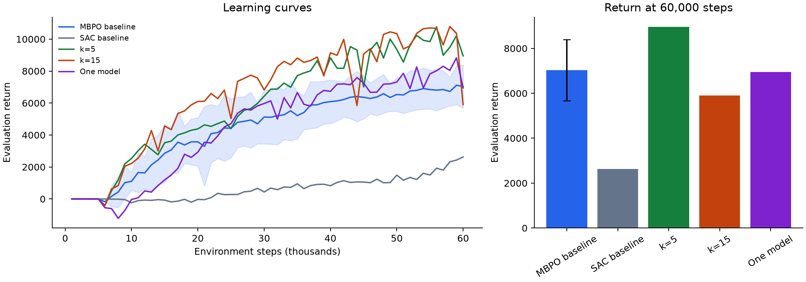
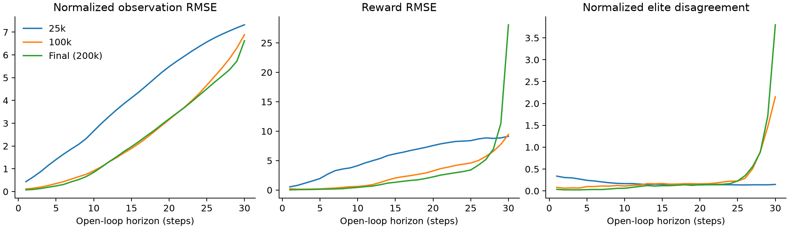

# Presentation notes: plots and conclusions

**Main message:** MBPO learns from far fewer environment steps than SAC, but pays for it in compute.
The ablations are exploratory: one seed each, and the k = 5 / k = 15 runs have a known bug (see slide 4).

Where the files are:

- Ablation plots: `results_ablation/` in this repository.
- Main-run plots and videos: `results/` and `videos/` inside the main run's `mbpo_results.zip`. They are not in the repository.

## Recommended slides

| # | Slide | Plot or video | Priority |
|---|---|---|---|
| 1 | What the agent learned | `videos/random_policy.mp4`, `videos/sac_baseline.mp4`, `videos/mbpo_trained.mp4` | must |
| 2 | Sample efficiency | `learning_curves.png` | must |
| 3 | Compute cost | `wall_clock.png` | must |
| 4 | Ablations | `ablation_returns.png`, **left panel only** | must |
| 5 | Why rollouts are kept short | `model_error_by_horizon.png`, left panel (state error) | must |
| 6 | The model improves with data | `model_loss.png` | optional |
| 7 | Critic check | `critic_calibration.png`, right panel | optional |

### 1. What the agent learned

- Returns of the recorded episodes: random −266, SAC 7,024, MBPO 12,206.
- Return is the total reward over 1000 steps. Return / 1000 is roughly the average speed in m/s.
- **Say:** the MBPO clip is the best policy of the better seed (seed 1), not a typical run.

### 2. Sample efficiency: `learning_curves.png`

| Run | Env steps | Final policy return (10 episodes) | Best policy return (10 episodes) | First reaches 3,000 | First reaches 5,000 |
|---|---|---|---|---|---|
| MBPO seed 0 | 200k | 8,715 ± 83 | 9,062 | 23k | 39k |
| MBPO seed 1 | 199k | 10,935 ± 1,567 | 12,122 | 13k | 21k |
| SAC seed 0 | 400k | 6,955 ± 78 | 7,027 | 70k | 145k |

The ± is the spread over evaluation episodes, not over seeds.

- **Conclude:** MBPO reaches SAC's 400k-step level with 4–9 times fewer environment steps.
  At 199k steps the curves are at 10,068 (MBPO, mean of two seeds) and 5,430 (SAC).
- **Caveats:** two MBPO seeds and one SAC seed. The band is the min–max of the two seeds, not a confidence interval.
  MBPO does 20 SAC updates per step and SAC does 1, and the target entropy differs (−3 and −6),
  so the gap cannot be credited to the learned model alone.

### 3. Compute cost: `wall_clock.png`

- **Conclude:** MBPO takes about 200 s per 1000 steps and SAC about 17 s, roughly 12 times more.
  SAC reaches 5,000 in 0.66 h; MBPO needs 1.97 h (seed 0) and 0.90 h (seed 1).
- **Say:** MBPO pays off when real environment steps are expensive, such as on a physical robot.
- **Caveat:** MBPO stopped at 200k of the planned 400k steps (11 h limit); SAC finished its 400k steps in 1.8 h.

### 4. Ablations: `ablation_returns.png`, left panel

**Do not show the right-hand bar chart.** It uses one evaluation at 60k. For k = 15 that evaluation was
5,899 (spread 4,004 over five episodes), while the nine before it were 9,386–10,784 and the final policy
scored 9,126 over 10 episodes. Put this table next to the curves instead:

| Configuration | Mean of last 5 evaluations (56–60k) | Evaluations with spread > 500 (of 30, 31–60k) |
|---|---|---|
| k = 1, seed 0 | 6,064 | 0 |
| k = 1, seed 1 | 7,745 | 0 |
| k = 5, seed 0 | 9,680 | 9 |
| k = 15, seed 0 | 9,471 | 6 |
| Single model, seed 0 | 8,028 | 2 |
| SAC, seed 0 | 2,222 | 1 |

- **Rollout length:** k = 5 and k = 15 scored higher than both k = 1 seeds, but were less stable.
  We expected k = 15 to be worse and did not see that.
- **Must disclose:** the model buffer was sized for k = 1 (400,000 transitions) and was not enlarged for k = 5 and
  k = 15. After each rollout it held only steps 2–5 (k = 5) or 12–15 (k = 15) of that rollout, whereas k = 1
  kept the last four rollouts. The runs change more than k, so they do not show what k alone does.
- **Single model:** 8,028 is 283 above the better k = 1 seed, while the two seeds differ by about 1,700.
  **Conclude only:** we could not measure a benefit of the ensemble on return by 60k steps.

### 5. Why rollouts are kept short: `model_error_by_horizon.png`

- **Conclude:** model errors compound. For the final model, normalised state error grows from 0.075 at 1 step to 6.6 at
  30 steps. It passes one standard deviation near step 11 (read off the plot).
- **Conclude:** one-step error falls with data: 0.435 (25k), 0.115 (100k), 0.075 (200k).
- **Caveats:** these are the main-run seed 0 models, replaying the final policy's actions. The plot explains the choice of
  short rollouts. It does not show that long rollouts hurt the return, and slide 4 did not show that either.
- Ensemble disagreement is not a reliable error estimate: for the 25k model it falls with horizon while the error rises.
  Leave out the reward panel, where the last steps diverge and dominate the scale.

### 6. The model improves with data: `model_loss.png` (optional)

- **Conclude:** holdout error falls to about 0.13 after an initial rise.
- **Caveats:** the holdout is re-drawn at each retrain while the weights carry over, so the value is optimistic.
  Crop the "0" at the end of the line: it is a rounding bug in the label.

### 7. Critic check: `critic_calibration.png`, right panel (optional)

- **Conclude:** Q is 44.5 below the soft return on average, so there is no sign of over-estimation.
- **Caveats:** seed 0, start states only. Leave out the left panel: it compares Q with a return that has no entropy term.

## Leave out

- The right panel of `ablation_returns.png` (see slide 4).
- `model_uncertainty.png`, unless "aleatoric" is explained as error the model cannot predict. HalfCheetah dynamics are
  deterministic, so it is not environment noise. The plot has the same "0" label bug.

## Claims to avoid

| Avoid | Use instead |
|---|---|
| "MBPO beats SAC because of the model" | "MBPO reached higher returns with fewer environment steps than our SAC baseline" |
| "MBPO reaches 12k" | "8.7k and 10.9k for the final policies of two seeds; the best policy reached 12.1k" |
| "Longer rollouts are better" or "worse" | "Our k = 5 and k = 15 runs scored higher, but a buffer bug confounds them" |
| "The ensemble helps" or "does not help" | "Inconclusive with one seed" |
| "Significant", "confidence interval" | "Two seeds", "min–max band" |

## Limitations slide (one line each)

1. Few seeds: two for MBPO, one for SAC and for each ablation.
2. SAC is not matched to MBPO in updates per step or target entropy.
3. MBPO stopped at 200k steps and had not clearly converged.
4. Seed 1 fails now and then: 8 of its 169 evaluations after 30k steps had a spread above 500.
5. The k = 5 and k = 15 runs used a model buffer sized for k = 1.
